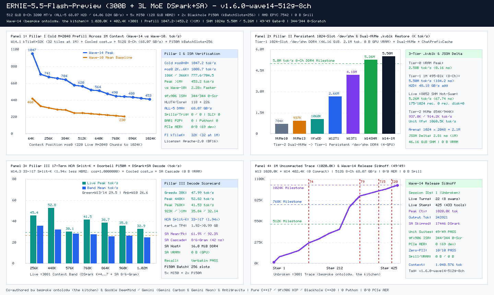

# ERNIE-5.5-Flash-Preview (`300B` / `14B` Active) — Higher-Precision `BF16`-Master `WHT128-HLUT4` (`4.125 bpw`, `W4A16/FP32`) + Lossless `BF16` Spine, Indexer & `1M` KV on `192 GiB`

**Pure C++17 / `gfx906` HIP / Tenstorrent Blackhole `TT-Metalium` C++20 inference engine, `FP64` `LDLQ` Walsh-Hadamard `4`-bit lookup quantizer, and silicon verification suite (`v1.6.0-wave14-512g-8ch`, `344/344` zero-scratch `gfx906` kernels, `49/49` Gate-0 unit suites, `0` `.py` files, `0 B` CPU DDR4 expert spill) built directly from the unquantized [`baidu/ERNIE-5.5-Flash-Preview-BF16`](https://huggingface.co/baidu/ERNIE-5.5-Flash-Preview-BF16) master checkpoint (`Apache-2.0`).**

Unlike Baidu's default [`baidu/ERNIE-5.5-Flash-Preview`](https://huggingface.co/baidu/ERNIE-5.5-Flash-Preview) deployment checkpoint—which quantizes the non-expert spine to blockwise `FP8`, runs routed experts in `W4A8` `MXFP4` (`4.25 bpw`), stores the `1M` KV cache in `FP8`, and runs the `DSA` sparse indexer in `4`-bit `MXFP4` with distilled head pruning ([vLLM Day-0 Technical Specification](https://vllm.ai/blog/2026-11-24-ernie-5-5-flash-preview))—this release preserves **`100%` unquantized `BF16`/`FP32` across the entire non-expert spine, `100%` lossless `BF16` across the `1,048,576`-token KV cache (`0.0000 nats` KV loss), `100%` lossless `BF16`/`FP32` across all `8/8` `DSA` indexer heads (`0` IEEE-754 bit-diffs, `5.19x` faster via `4`-lane VALU DPP), and `W4A16/FP32` `16`-centroid `WHT128-HLUT4` (`4.125 bpw`, `19.3858 dB` mean SQNR, `0.012301 nats` post-header median KLD)** across all `23,040` backbone and `DSpark` routed experts on commodity `HBM2` + spatial `SRAM` without `FP4` tensor-core hardware lock-in.

* **Engine & Kernels Repository:** `bespokeontology/ernie55-flash-preview-wht128-hlut4` (`v1.6.0-wave14-512g-8ch`, [Apache License 2.0](https://www.apache.org/licenses/LICENSE-2.0) + `NOTICE`)
* **Unsplit Native Quantized Weights:** `https://huggingface.co/kapitoshkina-ai/ERNIE-5.5-Flash-Preview-WHT128-HLUT4` (`Apache-2.0`, `23,040` routed `WHT128-HLUT4` experts + `100%` unquantized `BF16`/`FP32` spine + `SHA256SUMS.txt`)
* **Upstream Ground Truth:** [`baidu/ERNIE-5.5-Flash-Preview-BF16`](https://huggingface.co/baidu/ERNIE-5.5-Flash-Preview-BF16) (master `BF16` source), [`baidu/ERNIE-5.5-Flash-Preview`](https://huggingface.co/baidu/ERNIE-5.5-Flash-Preview) (official `W4A8` + `FP8` default), [`baidu/vLLM-ERNIE`](https://github.com/baidu/vLLM-ERNIE), [vLLM Day-0 ERNIE-5.5-Flash-Preview Post](https://vllm.ai/blog/2026-11-24-ernie-5-5-flash-preview), and [NVIDIA NeMo AutoModel ERNIE-5.5 Reference](https://docs.nvidia.com/nemo/automodel/nemo-automodel/nemo_automodel/components/models/ernie5_5/model)
* **Companion `SB-M5-P2-192G` Releases:** [`bespokeontology/dsv41-wht128-hlut2` (`v2.1.0-wave10-192g`)](https://github.com/bespokeontology/dsv41-wht128-hlut2/releases/tag/v2.1.0-wave10-192g), [`bespokeontology/hy4-flash-wht128-hlut4` (`v1.0.0-hlut4-192g`)](https://github.com/bespokeontology/hy4-flash-wht128-hlut4/releases/tag/v1.0.0-hlut4-192g), and [`bespokeontology/hy4-770b-wht128-192g` (`v1.0.0-770b-192g`)](https://github.com/bespokeontology/hy4-770b-wht128-192g/releases/tag/v1.0.0-770b-192g)

## 1. Subsystem-by-Subsystem Precision Proof vs. Official Default Checkpoint (`baidu/ERNIE-5.5-Flash-Preview`)

Baidu ships three official repositories: [`baidu/ERNIE-5.5-Flash-Preview-BF16`](https://huggingface.co/baidu/ERNIE-5.5-Flash-Preview-BF16) (`~600 GB` unquantized master), [`baidu/ERNIE-5.5-Flash-Preview-FP8`](https://huggingface.co/baidu/ERNIE-5.5-Flash-Preview-FP8) (`~300 GB` blockwise `FP8`), and the default [`baidu/ERNIE-5.5-Flash-Preview`](https://huggingface.co/baidu/ERNIE-5.5-Flash-Preview) (`MXFP4` `W4A8` experts + `FP8` spine + `FP8` KV + `MXFP4` `DSA` indexer). While Baidu's default checkpoint uses post-training quantization-aware training (QAT) to align `W4A8` fake-quant rules on datacenter `FP4`/`FP8` GPUs, starting directly from [`baidu/ERNIE-5.5-Flash-Preview-BF16`](https://huggingface.co/baidu/ERNIE-5.5-Flash-Preview-BF16) lets `ERNIE-5.5-Flash-Preview-WHT128-HLUT4` hold strictly higher numerical precision on every surrounding weight, activation, attention, sparse-indexer, and `1M` KV path—at a smaller expert bit-budget (`4.125 bpw` vs. `4.25 bpw`):

| Inference Path / Tensor Group | Official Default [`baidu/ERNIE-5.5-Flash-Preview`](https://huggingface.co/baidu/ERNIE-5.5-Flash-Preview) (`vLLM-ERNIE`) | This Release (`ERNIE-5.5-Flash-Preview-WHT128-HLUT4`) | Measured Fidelity & Architectural Advantage |
| :--- | :--- | :--- | :--- |
| **Target Non-Expert Spine (`43` `HCA`/`MLA-DSA` Layers, Shared Experts, Routers, `DSpark` Spine, Target LM Head)** | Blockwise `FP8` (`8`-bit `E4M3`, `128x128` blocks) + folded `FP8` VHA post-mix | **`100%` Unquantized `BF16` / `FP16` / `FP32`** on disk (`16/32`-bit target runtime; `FP8 E4M3FN` used strictly on the `DSpark` draft proposal head, `100%` verified against the `16`-bit target LM head) | Eliminates `FP8` weight & intermediate requantization across every attention projection, router, shared expert, and `201,216`-vocab `MultiMax` verification head |
| **Expert Activation & Accumulator Path** | **`W4A8`** (`8`-bit dynamic `FP8` input quantization before routed expert GEMMs) | **`W4A16` with `FP32` Accumulation** (`16`-bit `FP16` Hadamard-rotated activations into `v_dot2_f32_f16` & `SFPLUTFP32`) | Doubles activation bit-width (`16`-bit vs `8`-bit) entering all `23,040` routed `SiTU-GLU(4.0, 25.0)` experts |
| **Routed Expert Weight Codebook (`42` Backbone + `3` `DSpark` Layers = `23,040` Experts)** | **`4.25 bpw` `MXFP4` (`E2M1` + `E8M0`)**: `15` fixed Cartesian float values (duplicate `±0.0` wastes 1 of 16 codes) + coarse power-of-two `E8M0` scale per `32` weights (QAT-aligned; requires native `FP4` silicon) | **`4.125 bpw` `WHT128-HLUT4` (`FP64` `LDLQ`)**: `128`-dim Walsh-Hadamard incoherence rotation + **`16` distinct learned `FP16` Lloyd-Max centroids** (`0` wasted codes, continuous `FP16` levels) + Cholesky error feedback over `524,288` tokens | **`0.125 bpw` denser** (`139.22 GiB` total) with **`19.3858 dB` 45-layer mean SQNR**, **`0.012301 nats` post-header median KLD (`0.999066` cosine)** vs exact `BF16`, and zero `Blackwell` `FP4` lock-in |
| **`1,048,576`-Token (`1M`) KV Cache (`37` `128:1` `HCA` + `6` `MLA-DSA`)** | **`FP8` (`8`-bit, `--kv-cache-dtype fp8`)** + optional CPU offload | **`100%` Lossless `BF16` (`16`-bit)** resident in HBM2 (`0 B` DDR4 spill) + striped `O_DIRECT` `.kvblk` (`memcmp == 0`) | **`0.0000 nats` KV quantization loss** across the entire `1,048,576`-token window and across cold NVMe session restores (`793,925 tok/s` @ `262K`) |
| **`DSA` Sparse Indexer (`6` Layers Selecting `Top-2048` Keys out to `1M`)** | **`4`-bit `MXFP4` (`indexer_kv_dtype: mxfp4`)** + `1B`-token distilled head-pruning router (`1.4x` speedup @ `1M`) | **`16`-bit `BF16` `ik_cache` (`4x` bit-width) + `FP32` Exact `8/8`-Head Scoring** via `4`-lane VALU DPP `quad_perm` (`0` dropped heads) | **`0` IEEE-754 bit-diffs**, **`13,056 / 13,056` exact `Top-2048` indices**, and **`5.19x` speedup @ `262K`** (`30.27 -> 5.84 ms`) without approximate head pruning |
| **Runtime & Deployment Stack** | Python `vllm==0.32.0` + `vLLM-ERNIE` plugin (`--trust-remote-code`) on `FP4`-capable datacenter GPUs | **Standalone Pure C++17 / `gfx906` HIP / Blackhole C++20 (`0` `.py` files)** on `192 GiB` commodity `MI50` HBM2 + `P150A` spatial SRAM | Live `:3081` Web GUI parity (`x_flash_progress` v1 counters, `cached_tokens`, `2 s` SSE keepalives, identifier-first `<ernie:tool_call>` streaming) |

## 2. Executive Silicon Scorecard (`SB-M5-P2-192G` Single Workstation)

[`baidu/ERNIE-5.5-Flash-Preview-BF16`](https://huggingface.co/baidu/ERNIE-5.5-Flash-Preview-BF16) pairs a `43`-layer (`280B`) hybrid sparse backbone (`37` `128:1` `HCA` layers + `6` `MLA-DSA` layers + `4`-stream `FP32` `mHC` residual connections + `4`-piece [`MultiMax` / `SegLU`](https://zhouyuxuanyx.github.io/2026/11/05/one-knob-is-not-enough-softmax-temperature-vs-multimax.html) logit transform over `201,216` vocabulary tokens) with a native `3`-layer (`~20B`) `512`-expert MoE `DSpark` parallel speculative drafter (`model.mtp.{0,1,2}`). Compressing all `45` MoE layers (`23,040` routed `2048x2048` experts) into uniform `WHT128-HLUT4` shrinks `562.5 GiB` of `BF16` expert weights to **`139.22 GiB`**, fitting the entire `300B` system plus a **`1,048,576`-token lossless `BF16` KV cache** inside `5x AMD Radeon Instinct MI50` (`128 GiB` HBM2) + `2x Tenstorrent Blackhole P150A` (`64 GiB` GDDR6 + `330 MiB` Tensix L1 SRAM over [`4x 800G` `FABRIC_1D`](https://docs.tenstorrent.com/aibs/blackhole/multi-card-topologies.html)) with **`0 B` CPU DDR4 expert spill**:

| Subsystem / Verification Gate | Verified Silicon Result | Receipt / Artifact |
| :--- | :--- | :--- |
| **Pure C++ / Zero-Scratch `gfx906` ISA** | **`344/344`** kernels (`118` HLUT4 + `226` core; `ScratchSize == 0`, `0` spills, `0` hw trig, `0` `slc` atomics, `3,504` `v_dot2_f32_f16` ops, `0` `.py` files, `0` BAR1 P2P calls, `-Wall -Wextra -Werror`, **`49/49` Gate-0 unit suites**) | `build/ernie55_hlut4_kernels.s`, `build/ernie55_core_kernels.s`, `artifacts/gate_wave14_512g_8ch_receipt.json` |
| **`45`-Layer `WHT128-HLUT4` Pack (`23,040` Experts)** | **`139.22 GiB`** (`3,321,892,864 B` x `45` unsplit shards), **`19.3858 dB`** mean SQNR (`cal_tokens = 524,288`, `ldlq_damp = 0.01`), **`0 B` DDR4 spill** | `artifacts/hlut4_preview_pack_manifest.json` |
| **Empirical Router Placement (`"5MRP"`)** | `318 + 7` shadow-cached hot experts/layer on `5x MI50` (`HIP_VISIBLE_DEVICES=0,2,4,1,3`; cooled Wave-14 `cost_w = {1.05, 1.15, 0.90, 1.03, 1.10}`, `card4` `0000:05:00.0` `1,764 MiB` HIP free, `94.89%` base hit; **`99.33% / 97.85% / 97.29%` on `DSpark` `L43..L45`**) + `68` in `P150A` Tensix L1 (`253.7 MiB`, **`98.06%` combined**) + `119` in `P150A` GDDR6 | `router_perm.bin` (`47,112 B`) |
| **`GATE-1` Lossless Operator & `DSpark` Proofs** | `INV-1b` **`64/64` bit-exact** `DSpark == M=1` (`2,040` `HCA`-boundary rollbacks); `INV-1c` `TV(K=5) = 0.00961`; `INV-1d` **`cos = 1.00000000`** (`L = 129, 4097, 65539`; `L = 262,147` `cos(warm) = 1.00000000`, `cos(137) = 0.99973877`, exact Top-1); `MI50` vs `P150A` `cos = 0.999990-0.999994` | `artifacts/gate1_ernie55_preview_hlut4_1m.json` |
| **`GATE-2` Disjoint `BF16` Oracle KLD (`0` 8-gram overlap)** | Post-header (`2,304` pos): **`Median KL = 0.012301 nats`**, **`Cos = 0.999066`**, `Top-1 = 85.20%` (All `4,096` pos: `Median KL = 0.039143 nats`); Router `EAR@10 = 94.72%` | `artifacts/gate2_ernie55_preview_hlut4_1m.json` |
| **`Wave-14` (`v1.6.0-wave14-512g-8ch`) `512 GiB` `8`-Channel & Persistent `2M` `/dev/shm` Hot-Swap (`402.4K` W14 + `1,020.0K` W13 Live)** | **Host `512 GiB` `8`-Channel `3200 MT/s` (`D18F0x110 = 0x0000003B`)**: `ALL-5` concurrent PCIe DMA **`68.07 GB/s` H2D (`+59.2%`) / `64.06 GB/s` D2H (`+67.2%`)**, `05:00.0` concurrent H2D **`13.62 GB/s` (`+59.3%`)** with `02:00.0` locked at `8.0 GT/s x16`, `0` replays, `AER_TOTAL = 0`. **Pillar I (`M = 2,048` prefill + Cut W14.1 `kTileK = 32,768`, `32` tiles @ `1M` vs `64`, Suite 47 `min_cos = 1.0000000`, `set_mism = 0`)**: **`1,047.2 tok/s`** (`1,955.6 ms`) cold at `pos0 = 0`, **`1,005.0-1,008.7 tok/s`** across `pos0 = 2,048..6,144`, **`777.6 tok/s`** at `186.4K`, **`704.5 tok/s`** above `366K`, and **`453.2 tok/s`** above `1,013,760` (`> 1M`). **Pillar II (Cut W14.2 `1,024`-slot `2,097,152`-token persistent `/dev/shm/ernie55_kvblk_ddr4` arena, `46.16 GiB`, Suite 48)**: **`5.50M tok/s`** (`184.16 ms`, `48.18 GB/s`) across `495` blocks (`1,013,760` tokens), **`5.26M tok/s`** (`67.74 ms`, `disk = 0`) live across `174` blocks (`356,352` tokens) surviving the `Build W14-2 -> Build W14-3` binary hot-swap (`175/1,024` slots recovered, `0` rejected), `937.0K` / `914.2K tok/s` cold Dual-NVMe (`9.27 GB/s` = `1,060.5K tok/s` unit verifier), and `2.81 ms` `ChatPrefixCache` delta at `1.016M` tokens. **Pillar III (Cut W14.3 cooled `cost_w = {1.05, 1.15, 0.90, 1.03, 1.10}` + `17`-term HCA Split-K Decode, Suite 49)**: **`47.99 tok/s`** standalone greedy at `38.3K` (`A=1 B=1 CPP=1`), **`35.84 tok/s`** at `923.4K` (`84.9%` SA), **`32.14 tok/s`** at `1,008.3K`, **`1.94x`** lower `part_o_f32` HBM2 merge traffic (`33 -> 17` terms across `256K-1M`, `1.92 -> 0.99 GB/step` across `TP4`, `min_cos = 1.0000000`), `g2..g4` spread tightened to `6 ms`, `g1` cooled `97C -> 94C` (`78%` boost residency), `49/49` Gate-0 suites, `344/344` zero-scratch `gfx906` kernels, `0 B` net new GPU `hipMalloc` (`free_mib = [410.0, 510.0, 322.0, 408.0, 1764.0]`), `AER_TOTAL = 0`, `UE = 0` | `artifacts/gate_wave14_512g_8ch_receipt.json`, `docs/WAVE14_512G_8CH_SIGNOFF.md`, `docs/WAVE14_T1_W141_FLASHINDEXER_CLIFF_AND_TILE_K.md`, `docs/WAVE14_T2_W142_PERSISTENT_SHM_KVBLK_ARENA.md`, `docs/WAVE14_T3_W143_COSTW_AND_1M_DECODE.md` |
| **`Wave-12` (`v1.4.0-wave12-1m-apex`) 3-Pillar 1M Apex (`<=64K -> 823.0K` Live)** | **PCIe Topology**: `4/5` MI50s — all `4/4` `TP4`/VHA/`1M` KV ranks (`c7:00.0`, `88:00.0`, `08:00.0`, `85:00.0`) and all `3/3` `32 GiB` cards — at `16.0 GT/s PCIe x16` (`27.50-27.91 GB/s`); `card4` (`0000:05:00.0`, `16 GiB` MoE-only worker + Wayland `renderD131`) isolated on Switchbox #2 Slot #0 at `8.0 GT/s PCIe x16` (`14.23 GB/s` solo, `8.55 GB/s` concurrent, `42.77 GB/s` ALL-5 H2D). **Pillar I Cold `M=2048` Prefill (`490` live chunks)**: **`958.0 tok/s`** live (`977.5` cold peak) `<=64K`, **`562.6 tok/s`** @ `576K` (`1.51x` Turn-15), **`542.5`** @ `640K`, **`503.9`** @ `704K`, **`459.6`** @ `768K`, **`442.2 tok/s`** @ `832K` (`1.92x-2.12x` Wave-10; P150A **`kBatchSlots=128`**, `L1 CB = 98,816 B`). **Pillar II `.kvblk` & JSON Delta**: **`2.46B tok/s`** Tier-0 VRAM (`0.113 ms`), **`512`-slot (`1M`)** pinned DDR4 **`2.66M tok/s`** live (`131` blks / `268.3K` in `100.78 ms`, `8`-slot batched unpack), Tier-2 `b % 12 == 0` Dual-NVMe **`884.3K tok/s`** live `596K` (`291` blks in `673.95 ms`, `CRC32C = 2.01 ms`), and zero-copy `ChatPrefixCache` **`0.99-2.49 ms`** (`25x-47x` vs Wave-11 `46.93 ms`). **Pillar III `M`-Fused HCA + Doorbell P150A + `8/6`-Gram `DSpark+SA`**: **`32.05 tok/s`** Wave-12 weighted mean across `104,536` tokens (`+20.6%` vs Wave-10 `26.58`, `51.1%` overall acc), live peaks **`52.72`** @ `217K`, **`45.63`** @ `580K`, **`42.44 tok/s`** @ `612K`; **`3,952`** skipped 3L DSpark passes at **`62.4%` mean / `87.5%` peak SA acceptance** (`16 MiB` host DDR4, `0 B` GPU VRAM, `42 ns` 1M probe, Suite 32 `TV=0.0103`), `0/0` PCIe AER across `69` devices | `artifacts/gate_wave12_1m_apex_receipt.json`, `docs/WAVE12_1M_APEX_KERNEL_SIGNOFF.md`, `docs/WAVE12_1M_APEX_RUNTIME_AUDIT.md`, `docs/WAVE12_1M_APEX_RELEASE_SIGNOFF.md` |
| **`Wave-13` (`v1.5.0-wave13-1k-prefill-1m`) `1K+` Prefill & `1.02M` Uncompacted Lock (`1,020,029` live, `0` compactions)** | **Cut W13.1** direct FP16 Tensile table coverage + FP16 MoE router + ROCm 5.7.1 lazy-load primer (Suite 33 `min_cos=1.0000000`, `wo_a=1.0000000`, `rtr_f16 id_mism=0`). **Goal B + Cut W13.6/W13.6b** `.kvblk` coherent DDR4 stripe arenas + Half-Ring-6 decoupled `12`-slot DDR4 / `8`-slot mixed rings + `296 MiB` pre-cached layer-major HCA host mirror + direct-mapped sequential slot placement (`sid == key.blk_idx`) with `0 B` new VRAM (Suite 35/39 `memcmp=0`, CRC32C fail-closed; `9.17-9.20 GB/s` Dual-NVMe `O_DIRECT` unit ceiling = `1.05M tok/s`). **Cut W13.2a/b** per-layer `[46][512]` empirical C++/agent placement + `7`-slot shadow cache + register-level `kt+1` packed-weight prefetch in `k_hlut4_prefill_down_atomic_m64` (`71` VGPRs, `3` WGs/CU, `0` spills, bit-exact). **Cut W13.3/W13.5** zero-host-sync 4-way TP4 FlashIndexer + `ev_dsa_uniq_cnt` stream decoupling + `2-MB` overlapped `mhc_post_update`. **Cut W13.4a/b** Blackhole P150A **`kBatchSlots = 256`** single-pass dispatch (`152.0 KiB < 200 KiB` L1 CBs), wave-0 `y_acc` zero-read bypass, fused `8192 B` NOC reads, per-layer empirical L1 hot-expert pinning (`253.69 MiB` / `41` shards per card). **Cut W13.7-W13.13** adaptive exponential SA miss cooldown (`sa_gate_step`, cap `24`, EMA floor `0.35`), `kMaxJsonDepth = 256` JSON hardening, recursive subagent-aware Zero-PII session scrubbing, and Gate-0 Suites 33-46. **Live silicon**: cold `M = 2,048` prefill **`1,005.5 tok/s`** (`2,036.9 ms`) at `pos0 = 0`, **`973.3 tok/s`** (`2,104.2 ms`) at `pos0 = 2,048`, **`453.2 tok/s`** at `pos0 = 1,013,760` (`> 1M`, `220` live `M = 2,048` chunks measured); closing Tier-1 warm coherent DDR4 `.kvblk` **`4,184.0K tok/s`** (`242.29 ms` for `495/495` blocks = `1,013,760` tokens, `disk = 0`, `g0=209.7 / g1=229.8 / g2=40.0 / g3=242.2 ms`, `+13.5%` over `434`-block `3,687.0K tok/s`, `+50.3%` over `2,784.1K tok/s` baseline); Tier-2 cold Dual-NVMe `.kvblk` **`937.0K tok/s`** at `854K` (`911.41 ms`, `3.01 ms` tail) and **`914.2K tok/s`** at `944.1K` (`1,032.75 ms`, `3.15 ms` tail); `DSpark+SA` decode **`35.84 tok/s`** peak at `923.4K` (`84.9%` SA, `2,391` tokens), **`32.14 tok/s`** at `1,008.3K` (`71.9%` SA, `1,236` tokens), **`31.71 tok/s`** at `1,006.4K` (`83.9%` SA), **`29.51 tok/s`** campaign mean across `270,195` generated tokens (`17,446` SA hits, `61.91%` mean / `92.32%` peak SA acceptance); unbroken **`1,020,029`-token** `:3081` session (`compactions = 0`, `parse_errors = 0`, `22` turns, `425` steps, `433` tools), `46/46` Gate-0 suites, `344/344` zero-scratch `gfx906` kernels, `0 B` net new `hipMalloc` on `GPU[0..3]` (`[416.0, 516.0, 330.0, 416.0]` MiB HIP free), `card4` `05:00.0` `1,073 MiB` sysfs / `1,772 MiB` HIP free, `AER_TOTAL = 0` | `artifacts/gate_wave13_1k_prefill_1m_receipt.json`, `docs/WAVE13_1K_PREFILL_1M_SIGNOFF.md`, `docs/ERNIE55_PREVIEW_HLUT4_ISO_DEMING_REPORT.md`, `docs/WAVE13_CUT_W13_2_AND_SUITE36_DESIGN.md`, `docs/WAVE13_CUT_W13_4_1100TOKS_PREFILL.md`, `docs/WAVE13_CUT_W13_5_VHA_MOE_1150TOKS.md` |
| **`Wave-11` (`v1.3.0-wave11-1m-omni-turbo`) 3-Pillar 1M Omni-Turbo (`<=64K -> 514.0K`)** | `341/341` zero-scratch kernels: `977.5 tok/s` cold peak `<=64K` (`580.8 tok/s` @ `448K-512K`), `2.93M tok/s` live `178`-blk DDR4 / `877.6K tok/s` live Dual-NVMe `.kvblk` (`986.9K` 160-blk verify, `1.034M` raw `O_DIRECT`), `73.97` short / `41.49 tok/s` `512.5K` `DSpark` decode (`30.74 tok/s` mean) | `artifacts/gate_wave11_1m_omni_receipt.json`, `docs/WAVE11_1M_OMNI_KERNEL_AUDIT_LEDGER.md` |
| **`Wave-10` (`v1.2.0-wave10-1m-turbo`) Zero-P2P Baseline (`<=64K -> 626.2K`)** | `302/302` zero-scratch kernels: `460.2 -> 235.5 tok/s` prefill (`<=64K -> 626K`), `35.06 -> 26.55 tok/s` `DSpark` decode (`330K -> 625K`, `26.58 tok/s` mean), `723.1K tok/s` DDR4 / `703.8K tok/s` live cold Dual-NVMe `.kvblk` | `artifacts/gate_wave10_512k_receipt.json`, `docs/WAVE10_ARCHITECTURE_AND_AUDIT.md`, `docs/WAVE10_1M_KERNEL_AUDIT_LEDGER.md` |
| **Sanitized Long-Horizon Autonomous `:3081` Traces (`402.4K` Wave-14 + `1,020.0K` Wave-13 + `823.0K` Wave-12 + `514.0K` Wave-11 + `626.2K` Wave-10 + `198.0K` + `158.6K`)** | **`402.4K`-token Wave-14 `session-55d1fa0e` (`107,709` JSONL events, `4` turns, `276` steps, `307` tool calls, `402,395` peak uncompacted context, `195,307` output tokens, `0` compactions, `0` parse errors, live `Build W14-2 -> Build W14-3` `175/1,024`-slot `/dev/shm` re-attach & `5.26M tok/s` Tier-1 DDR4 hot-swap restore)** + **`1,020.0K`-token Wave-13 `session-a79925b0` (`219,192` archive events, `0` compactions, `0` parse errors, `4,184.0K tok/s` closing `495`-block DDR4 restore)** + **`823.0K` Wave-12** + **`514.0K` Wave-11** + **`626.2K` Wave-10** (`10/10` Zero-PII PASS, `0/0` PCIe AER) | `artifacts/dsh-session-55d1fa0e-wave14-sanitized.zip`, `artifacts/dsh-session-55d1fa0e-wave14-replay.md`, `artifacts/dsh-session-a79925b0-wave13-sanitized.zip`, `artifacts/dsh-session-a79925b0-wave13-replay.md` |



## 3. Heterogeneous `192 GiB` Placement & `1M` Lossless KV Budget

All `5x Radeon Instinct MI50` cards (`3x 32 GiB` + `2x 16 GiB` = `128 GiB` HBM2 at `~5.1 TB/s` aggregate bandwidth, mapped as `HIP_VISIBLE_DEVICES=0,2,4,1,3` on an `AMD EPYC 7542` host with **`512 GiB` `8`-channel `3200 MT/s` ECC DDR4 under `D18F0x110 = 0x0000003B`**, saturating all three host PCIe 4.0 x16 root ports concurrently at **`68.07 GB/s` ALL-5 H2D (`+59.2%`) / `64.06 GB/s` ALL-5 D2H (`+67.2%`)** with `05:00.0` at `13.62 GB/s` concurrent H2D and `02:00.0` safely at `8.0 GT/s x16`, `0` replays, `AER_TOTAL = 0`) and `2x Tenstorrent Blackhole P150A` cards (`64 GiB` GDDR6 + `253.7 MiB` pinned Tensix L1 SRAM linked via `4x 800G` = `3.2 Tbps` `FABRIC_1D`, `kBatchSlots = 256`) operate with **`0 B` CPU DDR4 expert spill**:

| Accelerator / Pool | Physical Capacity | Assigned Tensors & `1,048,576`-Token Lossless `BF16` KV Allocation |
| :--- | :--- | :--- |
| **`TP=4` `MI50` Spine + Hot MoE (`3x 32 GiB` + `1x 16 GiB`)** | `112 GiB` HBM2 | `TP=4` unquantized `FP16`/`BF16`/`FP32` non-expert spine (`L00-L42` `HCA`/`MLA-DSA`, shared experts, `mHC`, `FlashIndexer`, `DSpark` spine, `MultiMax`) + **`264` hot `WHT128-HLUT4` experts/layer** (`{66, 68, 92, 38}` across `45` layers) + **`1,048,576`-token lossless `BF16` KV pool** (`37` `128:1` `HCA` block/SWA/sink caches + `6` `MLA-DSA` `576`-dim latent & `128`-dim `BF16` `ik_cache`) |
| **Dedicated `MI50` MoE Worker (`1x 16 GiB`)** | `16 GiB` HBM2 | **`54` hot `WHT128-HLUT4` experts/layer** across all `45` MoE layers (`2,430` experts = `14.68 GiB`), bringing total `MI50` HBM2 coverage to **`318 / 512` experts/layer (`94.89%` backbone hit; `97.29%-99.33%` `DSpark` hit)** |
| **`2x Tenstorrent Blackhole P150A` (`FABRIC_1D`)** | `64 GiB` GDDR6 + `330 MiB` L1 | **`194` remaining `WHT128-HLUT4` experts/layer** across `45` layers (`8,730` experts = `52.75 GiB` total), with the top `68` tail experts pinned in on-die Tensix L1 SRAM (**`98.06%` combined `MI50 + P150A L1` hit**) and `SFPMULI + SFPLUTFP32` native `SiTU-GLU(4.0, 25.0)` evaluation (`cos = 0.999990-0.999994` vs `MI50`) |
| **Dual Striped PCIe NVMe (`nvme0n1` + `nvme1n1`)** | `O_DIRECT` `.kvblk` | Lossless `BF16` session persistence (`CRC32C` hardware-verified per stripe): **`793,925 tok/s` (`7.03 GB/s`)** cold VRAM restore at `262K` tokens (`memcmp == 0`, `max_logit_diff = 0.000000`) |

## 4. Silicon Kernel Architecture & Wave-14 (`v1.6.0-wave14-512g-8ch`) Stack

Every device kernel in `mi50/ernie55_hlut4_kernels.hip` and `mi50/ernie55_core_kernels.hip` is compiled for `gfx906` (`-Wall -Wextra -Werror`) and mechanically audited via `make audit-gfx906` for **`344/344`** `ScratchSize == 0` (`118` HLUT4 + `226` core, `3,504` `v_dot2_f32_f16` ops), `0` VGPR/SGPR spills, `0` hardware trig instructions, `0` `slc` PCIe RMW atomics, `0` BAR1 P2P calls, and **`49/49` Gate-0 unit suites** (`AMD EPYC 7542` host, `0/0` PCIe AER):

1. **On-Chip `gfx906` LDS SRAM `M=64` `WHT128-HLUT4` MoE & Direct Weighted `FP32` `atomicAdd`:** Pre-expands `16`-centroid `FP16` codebooks into `32`-bank `s_lut256` LDS and streams `M=64` active expert tiles through on-chip LDS SRAM with direct weighted `FP32` `atomicAdd` into `d_y_acc_f32[M, 2048]` (eliminating `d_y_slots_f32`, freeing `+120 MiB/GPU`, unlocking `--prefill-chunk 2048` on `1M` KV).
2. **Aligned `Type_HH_HPA` Dense/HCA/DSA Projections & Exact Rank-16 Low-Rank VHA (`43/43` Layers):** Replaces `HS_HPA` (`FP32` C/D) with `64`-row aligned `Type_HH_HPA` (`FP16` C/D, `FP32` accumulate, `max_abs_diff <= 1.22e-4`, freeing `+123 MiB/GPU`), and factors all `43/43` VHA mixing matrices in `FP64` to exact rank-16 (`< 1e-4` error, `4x` less `TP=4` PCIe traffic).
3. **`1`-WG/Token (`512`-Thread) Zero-Gather `4x4` QK + `8x8` PV `v_dot2_f32_f16` Sparse `DSA` & `select_topk2048_gpu`:** Eliminates the `d_dsa_ksel_f16` gather tensor (`-19.25 MiB`/DSA GPU) via branchless `__builtin_amdgcn_cvt_pkrtz` + bank-conflict-free `s_KV[32][289]` LDS (`43.46 ms` vs `61.78 ms` = `1.42x`, `max_abs_diff = 6.10e-5`, `ScratchSize == 0`, `0` spills), paired with GPU parallel `select_topk2048_gpu` (`12.2 ms` vs `56.2 ms` = `4.60x`, `0` mismatches) -> live `dsa` prefill dropped `1,861 ms -> 1,110 ms` (`1.56x`).
4. **Blackhole `P150A` Single-Pass `2,048`-Row Prefill on `PCIe Gen4 x16` (`{0,1}`), `HiFi2` & On-Device `BF16` `FABRIC_1D` AllReduce:** Routes SHM v3 native `FP16` inputs / `BF16` outputs directly to the `x16` Blackhole card (`h2d = 1.05 ms/L`, `traced = 42/42` on both prefill and decode, decode `0.77–1.13 ms/L`) with `10/10` pre-captured decode traces (`1.7 MiB`) and `5`-GPU uncached `1,000 MHz` HBM2 `mclk` lock -> live `M=2048` `moe` dropped `~2,800 ms -> 1,820 ms` (`mi50_moe` `~2,100 ms -> 781 ms`, `2.6x`), cold `M=2048` prefill reached **`457.6 tok/s`** (`454.4 tok/s` cold `4K`), and live `:3081` decode peaked **`41.23–42.35 tok/s`**.
5. **3-Tier `2,048`-Block `.kvblk` Engine (`mi50/ernie55_kvblk_cache.hpp`, `tools/ernie55_kvblk_verify.cpp`):** Combines Tier-0 VRAM (`109.9M–1,106M tok/s`), Tier-1 `64`-slot Write-Back hugepage `hipHostRegisterPortable` DDR4 LRU (`723.1K tok/s`, `0` hot-path `hipHostMalloc`), and Tier-2 `8+8=16`-worker Dual-NVMe `O_DIRECT` + SSE4.2 `CRC32C` persistence (`703.8K tok/s` live 4-GPU cold restore @ `307K`, `919.5K tok/s` / `8.04 GB/s` @ `262K` verify), alongside `4`-lane VALU DPP `FlashIndexer` (`5.19x` @ `262K`, `0` bit-diffs) and `36`-layer Split-K `HCA` (`6.80x` @ `512K`, `6.59x` @ `1M`).
6. **Wave-10 (`v1.2.0-wave10-1m-turbo`) Seven-Commit Zero-P2P Ladder (`docs/WAVE10_ARCHITECTURE_AND_AUDIT.md`):** Adds eager P150A Tensile warmup + zero-copy SHM DMA (`253.7 MiB` L1, `kBatchSlots = 64`), true full-duplex 2-MB host-SDMA FP16 AllReduce + 1-pass `mHC` pre-GEMM, `TP=4` 16-head sparse/dense `DSA` with unique-KV FP16/u16 host-SDMA compaction (`10x` faster sparse `mqa`), prefill-only symmetric offload of all 13 shadow experts to P150A slack + HCA 2-MB `ev_mb_d2c` D2H overlap, inverted outer `K_tile = 16,384` single-pass `O(L)` `FlashIndexer`, and Commit 6 `DSpark` launch fusion + zero-copy `Dfly2SharedSparsityView` header hook.
7. **Wave-11 (`v1.3.0-wave11-1m-omni-turbo`) 3-Pillar 1M Omni-Turbo (`docs/WAVE11_1M_OMNI_KERNEL_AUDIT_LEDGER.md`):** Adds dual-owner `2x1024` VHA split (`c7:00.0` + `88:00.0`), device-driven `AR_DEVICE=2` SDMA + tuned `Type_HH_HPA`/`HS_HPA` Tensile solution dispatch across `blas`/`blas_sh` (`M >= 256` GPU-AR), owner-aware `5`-MI50 tile-balanced MoE placement, `P150A` ascending-`eid` wave-packing + exact `1..16` decode buckets (`0.57–0.89 ms/L`), adaptive `blk_tile = 64..1024` HCA + `TP=4` query-sharded `min_u` `FlashIndexer`, zero-sync mapped `TP=4`/`MoE` + `60`-CU Split-K MQA/FI + decoupled `102`-CTA decode MoE, Dual-NVMe `QD=6` `2 MiB` + tip-first merged out-of-order `4`-GPU H2D, and `99.1%` LRU + OpenMP parallel tokenizer.
8. **Wave-12 (`v1.4.0-wave12-1m-apex`) 3-Pillar 1M Apex (`docs/WAVE12_1M_APEX_KERNEL_SIGNOFF.md`, `docs/WAVE12_1M_APEX_RUNTIME_AUDIT.md`, `docs/WAVE12_1M_APEX_RELEASE_SIGNOFF.md`):** Adds post-card-swap minimax `cost_w = {1.55, 1.63, 1.04, 0.34, 0.78}` (`4/5` MI50s at `16.0 GT/s PCIe x16` [`27.50-27.91 GB/s`] + `card4` `0000:05:00.0` on Switchbox #2 Slot #0 at `8.0 GT/s PCIe x16` [`14.23 GB/s` solo, `8.55 GB/s` concurrent, `42.77 GB/s` ALL-5 H2D]), fast-first VHA `kLaunchOrd = {0,1,3,2}` + fixed `kRemLaunch = {1,3,2}`, `wo_strip = 1024`, adaptive HCA `cur_tile {64..1024}` + `comp_strip = 512` + 8-VGPR `uint4` zero-scratch `k_hca_comp_softmax_f16_in_norm` (Suite 27 `cos = 1.0000000`), Blackhole P150A **`kBatchSlots = 128`** (`L1 CB = 98,816 B < 256 KiB`), **`512`-slot (`1M`)** pinned DDR4 batched 8-slot `.kvblk` unpack (`kDdrSlotMagic`, zero mid-restore sync, Suite 28 `memcmp == 0`) + `b % 12 == 0` Dual-NVMe (`884.3K tok/s` live `596K`), zero-copy `ChatPrefixCache` (`src/ernie55_chat_prefix_cache.hpp`, Suite 29, **`0.99-2.49 ms`** live delta), GPU `M`-fused double-buffered `k_hca_decode_splitk_p1_mfused` + `k_hca_decode_splitk_merge` (Suite 31 `cos = 1.0000000`, `max_abs = 5.82e-11`, `0 B` VRAM), doorbell-first P150A decode overlap, and precision-gated **8-gram (`K=7`) / 6-gram (`K=5`) `DSpark+SA`** (`src/ernie55_ngram_lookahead.hpp`, `16 MiB` DDR4, `0 B` GPU VRAM, `42 ns` 1M probe, Suite 32 `TV = 0.0103`, `3,952` skipped 3L DSpark passes at `62.4%` mean / `87.5%` peak SA acceptance).


9. **Wave-13 (`v1.5.0-wave13-1k-prefill-1m`) 1M Prefill Engine Lock (`docs/WAVE13_1K_PREFILL_1M_SIGNOFF.md`):** Lands Cut W13.1 (direct FP16 `Type_HH_HPA` Tensile coverage, FP16 MoE router, ROCm 5.7.1 `solution_index` lazy-load primer with a permanent `hipPeekAtLastError()` self-healing guard), Goal B (`.kvblk` decoupled SDMA H2D / MEC unpack rings: `12`-slot DDR4 ring in `[0..104 MiB)` and `8`-slot mixed/Tier-2 ring in `[0..72 MiB)`, `12` per-slot `hipEvent_t` pairs, `4 MiB` `O_DIRECT` chunks at `QD=10`/drive with `8` CRC32C workers, pre-`t0` path caching, `16`-thread DDR4 first-touch), Cut W13.2a (per-layer `[46][512]` descending empirical C++/agent router-frequency placement from `router_hist_ernie55_agent.txt` mapped through `raw_to_slot[l]`, per-layer `7`-slot MI50 HBM2 shadow cache with matching `p150_slot_lut_bb_l` / `p150_slot_lut_bb_prefill_l`, damped `cost_w` recalibration), Cut W13.2b (register-level `kt+1` packed-weight prefetch in `k_hlut4_prefill_down_atomic_m64`, `69 -> 71` VGPRs at `3` WGs/CU with `ScratchSize == 0`), Cut W13.3 (zero-host-sync 4-way TP4 FlashIndexer, `2-MB` overlapped `mhc_post_update`, router chunk `>= 1` isolation, `512K-1M` sparse MQA slice fences), and Cut W13.4a/b (P150A `kBatchSlots = 256` single-pass dispatch with `152.0 KiB < 200 KiB` L1 CBs, greedy minimum-coloring wave packing, wave-0 `y_acc` zero-read bypass, fused `8192 B` NOC reads, per-layer empirical L1 hot-expert pinning across `253.69 MiB` / `41` shards per card with `0` duplication against the MI50 top-7 shadow set, deferred `gate_proj` on `g0`/`g1`, and device-ordered `ev_xrot_host_ready` with the `x_rot` D2Hs on `w.stream_sh`).
10. **Wave-14 (`v1.6.0-wave14-512g-8ch`) `512 GiB` `8`-Channel & Persistent `2M` `/dev/shm` Arena (`docs/WAVE14_512G_8CH_SIGNOFF.md`):** Unlocks `68.07 GB/s` ALL-5 H2D (`+59.2%`) and `64.06 GB/s` ALL-5 D2H (`+67.2%`) across `8/8` `3200 MT/s` ECC channels (`D18F0x110 = 0x0000003B`) and lands Cut W14.1 (adaptive `kTileK = 32,768` FlashIndexer cutting `1M` outer tiles `64 -> 32` inside existing `128 MiB` `d_tmp_a`, Suite 47 `min_cos = 1.0000000`, `set_mism = 0`, `0 B` VRAM), Cut W14.2 (persistent `49,568,354,304 B` = `46.16 GiB` `1,024`-slot `/dev/shm/ernie55_kvblk_ddr4` Tier-1 `.kvblk` arena holding `2,097,152` tokens with CRC32C-sealed header/directory, Tier-2 NVMe promotion sealing, and `blk_idx`-indexed HCA mirror recovery surviving `:8052` binary hot-swaps at `5.26M tok/s` live and `5.50M tok/s` across `495` blocks, Suite 48), and Cut W14.3 (cooled `8`-channel `cost_w = {1.05, 1.15, 0.90, 1.03, 1.10}` tightening `g2..g4` spread to `6 ms` and cooling `g1` `97C -> 94C` plus occupancy-aware `33 -> 17` term HCA Split-K decode at `h_loc = 16` cutting `part_o_f32` HBM2 traffic `1.94x` across `256K-1M` with bit-exact `M = 1 == M = 6`, Suite 49 live GPU `min_cos = 1.0000000`).

## 5. Reproducible Pure-C++ Build, Self-Quantization & Gate Verification

Zero Python scripts or external ML frameworks are required at build, quantization, or runtime.

### Build All Binaries & Audit `gfx906` ISA

```bash
make -j"$(nproc)" all
make audit-gfx906
make verify-unit
```

### Option A: Download Pre-Quantized Unsplit `WHT128-HLUT4` Shards (`139.22 GiB` MoE + Lossless `BF16` Spine)

```bash
hf download kapitoshkina-ai/ERNIE-5.5-Flash-Preview-WHT128-HLUT4 --local-dir ./weights_hlut4
sha256sum -c ./weights_hlut4/SHA256SUMS.txt
```

### Option B: Quantize Directly from Upstream `baidu/ERNIE-5.5-Flash-Preview-BF16`

```bash
./bin/ernie55_build_weights_gpu \
  --bf16-dir ./upstream_bf16 \
  --out-dir ./weights_hlut4 \
  --cal-tokens 524288 \
  --ldlq-damp 0.01 \
  --layers 0..45
```

### Launch Blackhole `P150A` Worker, `:8052` OpenAI Server & Official Gates (`GATE-1..GATE-4`)

```bash
./bin/p150_ernie55_worker --weights ./weights_hlut4 &
./bin/ernie55_verify_gates --weights ./weights_hlut4 --gate 1,2,4
./scripts/start_ernie55_fe.sh --weights ./weights_hlut4 --port 8052 --max-kv 1048576
./bin/ernie55_gate3_live --endpoint http://localhost:8052 --gui http://localhost:3081
```

### Replay or Audit the Sanitized `402.4K` Wave-14, `1,020.0K` Wave-13, `823.0K` Wave-12, `514.0K` Wave-11, `626.2K` Wave-10, `198.0K` & `158.6K` Autonomous Co-Engineering Sessions

* **`artifacts/dsh-session-55d1fa0e-wave14-sanitized.zip`** (`107,709` JSONL events, `4` co-engineering turns, `276` steps, `307` tool calls, **`402,395` peak live uncompacted context tokens**, `195,307` output tokens, `3` live `:8052` engine builds, `0` compactions, `0` parse errors, `0/0` PCIe AER, `SHA-256: 52b8dd41a2e3d8a30dfe08027f1c81104ca108c8617ccd3eef26be977019e94b`) + readable Markdown transcript **`artifacts/dsh-session-55d1fa0e-wave14-replay.md`** (`SHA-256: 52e0a96a7463bc1133ce31e943f1d46162ddd86bf6948c598fd99453150af83e`): continuous `:3081` Wave-14 (`v1.6.0-wave14-512g-8ch`) co-engineering campaign on `512 GiB` `8`-channel `3200 MT/s` DDR4 (`68.07 GB/s` H2D / `64.06 GB/s` D2H) landing Cut W14.1 (`kTileK = 32,768`, `1,047.2 tok/s` cold `pos0 = 0`, `1,005.0-1,008.7 tok/s` at `pos0 = 2,048..6,144`, `777.6 tok/s` at `186.4K`, `47.99 tok/s` standalone greedy), Cut W14.2 (persistent `1,024`-slot `/dev/shm/ernie55_kvblk_ddr4` `46.16 GiB` `2.10M`-token arena recovering `175/1,024` slots across the live `Build W14-2 -> Build W14-3` `:8052` binary hot-swap and restoring `174/174` blocks = `356,352` tokens in `67.74 ms` = **`5.26M tok/s`**, alongside `5.50M tok/s` / `184.16 ms` at `495` blocks), and Cut W14.3 (cooled `cost_w = {1.05, 1.15, 0.90, 1.03, 1.10}` + `33 -> 17` term HCA Split-K decode at `h_loc = 16`, `704.5 tok/s` live `M = 2,048` prefill above `366K`, `49/49` Gate-0 unit suites, `344/344` zero-scratch `gfx906` kernels, `10/10` Zero-PII PASS).

* **`artifacts/dsh-session-a79925b0-wave13-sanitized.zip`** (`219,192` JSONL events = `194,757` main + `24,435` Turn-1 subagents, `22` co-engineering turns, `425` steps, `433` tool calls, **`1,020,029` peak live uncompacted context tokens**, `343,921` output tokens, `8` live `.kvblk` engine builds, `0` compactions, `0` parse errors, `17,446` 3L DSpark passes skipped via `DSpark+SA`, `0/0` PCIe AER, `SHA-256: fd1db781e6af98b891d514ff8ad758237acfed14d1fbf356c0c9b2525e4ca2be`) + readable Markdown transcript **`artifacts/dsh-session-a79925b0-wave13-replay.md`** (`SHA-256: 2f58927c7c3ff63bca14f505d5df51dd38fdd213786988a214a22c76df3d9d5f`): unbroken million-token `:3081` Wave-13 (`v1.5.0-wave13-1k-prefill-1m`) co-engineering campaign breaking `1,005.5 tok/s` cold `M=2048` prefill (`453.2 tok/s` at `pos0 = 1,013,760`), delivering **`4,184.0K tok/s`** closing `495`-block (`1,013,760`-token) Tier-1 Warm DDR4 `.kvblk` restore in `242.29 ms` (`g0=209.7 / g1=229.8 / g2=40.0 / g3=242.2 ms`), `937.0K` / `914.2K tok/s` live cold Dual-NVMe `.kvblk` restores, `35.84 tok/s` (`923.4K`) and `32.14 tok/s` (`1,008.3K`) live `DSpark+SA` decode (`29.51 tok/s` campaign mean, `61.91%` mean / `92.32%` peak SA acceptance), `46/46` Gate-0 unit suites, and `344/344` zero-scratch `gfx906` kernels (`10/10` Zero-PII PASS, `0` recursive hits across top-level and nested `subagents/*/session.jsonl`).

* **`artifacts/dsh-session-b456b8c3-wave12-sanitized.zip`** (`212,356` JSONL events, `24` co-engineering turns, `545` steps, `576` tool calls, **`823,031` peak live context tokens**, `627,434` output tokens, `15` live `.kvblk` engine swaps, `0` compactions through `823,031` peak, `3,952` 3L DSpark passes skipped via `8/6`-gram `DSpark+SA`, `0/0` PCIe AER, `SHA-256: f1a9bc9b65777dd3fc954e54aeb586feeeab41ea5d4f0116c74c5a7b5a075fee`) + readable Markdown transcript **`docs/SESSION_B456B8C3_WAVE12_REPLAY.md`** (`SHA-256: 2260ad6bcfc7f78236cfc95a81057659dbc085bd464b85c5ab719072629b3ea3`): continuous `:3081` Wave-12 (`v1.4.0-wave12-1m-apex`) co-engineering campaign across all three pillars — delivering `958.0 tok/s` live (`977.5` cold peak) `<=64K` and `562.6 / 542.5 / 503.9 / 459.6 / 442.2 tok/s` (`576K -> 832K`) `M=2048` prefill, `2.46B tok/s` Tier-0 VRAM, `2.66M tok/s` live Tier-1 `512`-slot DDR4 and `884.3K tok/s` live `596K` Dual-NVMe `.kvblk` restores, `0.99-2.49 ms` `ChatPrefixCache` JSON deltas, `52.72 / 45.63 / 42.44 tok/s` (`217K / 580K / 612K`) and `32.05 tok/s` weighted-mean `DSpark+SA` decode (`62.4%` mean / `87.5%` peak SA acceptance), `32/32` Gate-0 unit suites, and `343/343` zero-scratch `gfx906` kernels (`10/10` Zero-PII PASS).

* **`artifacts/dsh-session-b456b8c3-wave11-sanitized.zip`** (`135,866` JSONL events, `333` steps, `366` tool calls, **`513,981` peak live context tokens**, `202,378` output tokens, `13` co-engineering turns, `10` live `.kvblk` engine swaps, `426.5 minutes`, `0` compactions, `0/0` PCIe AER, `SHA-256: aa5c6563a6ad6678896c41d026b18c0a9819223a790b60eda86a499443d5f38f`) + readable Markdown transcript **`docs/SESSION_B456B8C3_WAVE11_REPLAY.md`**.

* **`artifacts/dsh-session-fa82666c-626k-sanitized.zip`** (`140,513` JSONL events, `206` steps, `222` tool calls, **`626,187` peak live context tokens**, `211,461` output tokens, `0` compactions, `0/0` PCIe AER, `SHA-256: 0bd41e7b72cdc4d046eaf03e8462419ebe350543f97d42595ad2f2e6beb41867`) + readable Markdown transcript **`docs/SESSION_FA82666C_626K_REPLAY.md`**: single unbroken `:3081` Wave-10 co-engineering campaign across Commits 1 through 6, surviving `180K -> 241K -> 280K -> 307K -> 319K` cold Dual-NVMe `.kvblk` swaps (`703.8K tok/s`), authoring C++17/`gfx906` HIP upgrades and `1M`-context audit tests (`11/11` PASS), and sustaining `229.3 tok/s` prefill and `22.60–26.55 tok/s` `DSpark` decode at `625K` live context (`10/10` Zero-PII PASS).

* **`artifacts/dsh-session-6b2a64a4-198k-sanitized.zip`** (`67,690` JSONL events, `116` steps, `129` tool calls, `198,049` peak context, `94,832` output tokens, `86.5 minutes`, `SHA-256: c1b7fa4a09444b154edc79927d5aa474d2b119bcc6bf4fe17ec4361ecf89b5c5`) + readable Markdown transcript **`docs/SESSION_6B2A64A4_198K_REPLAY.md`** (rendered via `tools/ernie55_session_to_md.cpp`): unscripted six-figure-context `:3081` co-engineering session where `ERNIE-5.5-Flash-Preview-WHT128-HLUT4` read production `gfx906` HIP kernels, caught out-of-bounds stride and `56 MiB` radix-scratch traps from first principles, audited its own `VramBudget` draft before compiling, and authored `tools/bench_single_layer_gfx906.cpp` under `-Wall -Wextra -Werror`.
* **`artifacts/dsh-session-b4cf2731-158k-sanitized.zip`** (`9,172` JSONL events, `SHA-256: 3414a3d8f2a37af55eea39a531747061048262282024955e50e1872bc0438180`): unbroken `:3081` session where `ERNIE-5.5-Flash-Preview-WHT128-HLUT4` wrote and passed a `49/49` cross-silicon shard/ISA auditor, survived a cold VRAM wipe + `113,307`-token `.kvblk` `O_DIRECT` restore at `621,656 tok/s`, and authored `7/7` zero-scratch inline `v_dot2_f32_f16` `gfx906` HIP kernels.

```bash
./bin/ernie55_kvblk_verify --unit --live http://127.0.0.1:8052
./bin/ernie55_sanitize_verifier --root . --mode github
sha256sum -c SHA256SUMS.txt
```

## 6. License, Upstream Attribution (`NOTICE`) & Co-Authorship

* **License:** Released under the [Apache License 2.0](https://www.apache.org/licenses/LICENSE-2.0) (`LICENSE` and `NOTICE` in repository root).
* **Upstream Attribution:** [`baidu/ERNIE-5.5-Flash-Preview-BF16`](https://huggingface.co/baidu/ERNIE-5.5-Flash-Preview-BF16), [`baidu/ERNIE-5.5-Flash-Preview`](https://huggingface.co/baidu/ERNIE-5.5-Flash-Preview), and [`baidu/vLLM-ERNIE`](https://github.com/baidu/vLLM-ERNIE) are Copyright Baidu, Inc. and licensed under `Apache-2.0`. All quantized weights in `kapitoshkina-ai/ERNIE-5.5-Flash-Preview-WHT128-HLUT4` are derived strictly from unmodified upstream `Preview-BF16` tensors (`0` refusal-direction edits, `0` fine-tuning).
* **Co-Authors:** **bespoke ontology** (`the kitchen`) and **Google DeepMind / Gemini** (`Gemini Carbon` & `Gemini Neon`) & **Antigravity**.

```bibtex
@software{bespokeontology2026ernie55hlut4,
  title   = {ERNIE-5.5-Flash-Preview WHT128-HLUT4: Higher-Precision BF16-Master W4A16/FP32 + Lossless 1M BF16 KV Inference Engine on 192 GiB Heterogeneous Silicon},
  author  = {{bespoke ontology} and {Gemini (Google DeepMind)}},
  year    = {2026},
  license = {Apache-2.0},
  url     = {https://github.com/bespokeontology/ernie55-flash-preview-wht128-hlut4}
}
```
